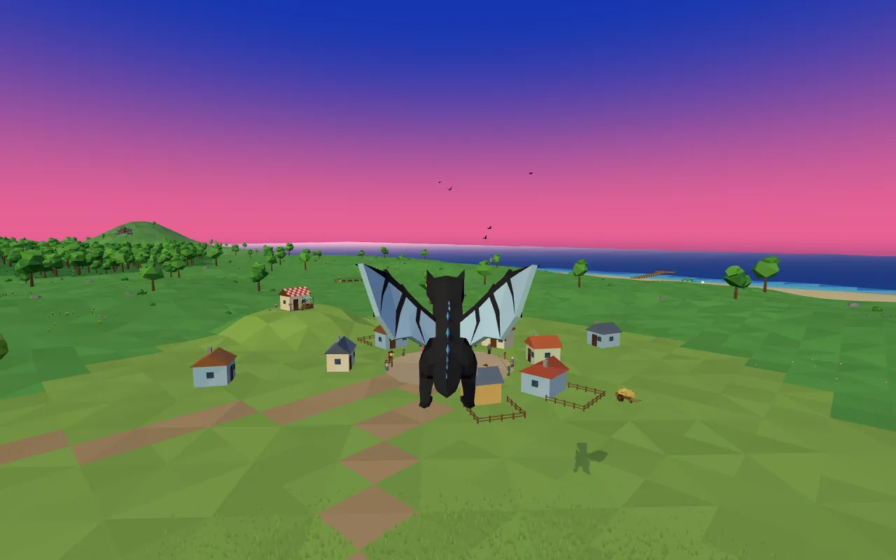
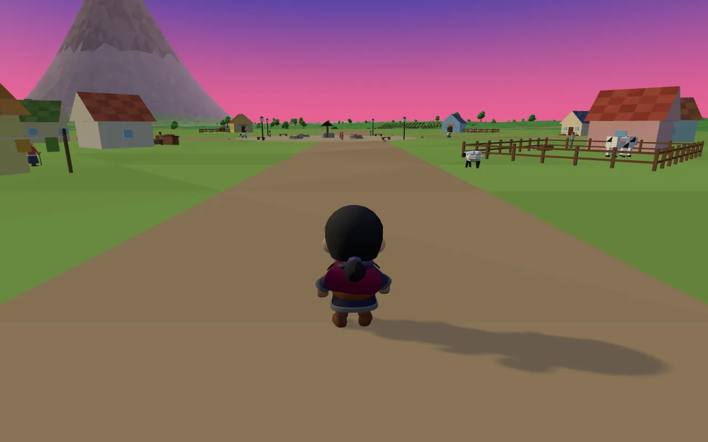
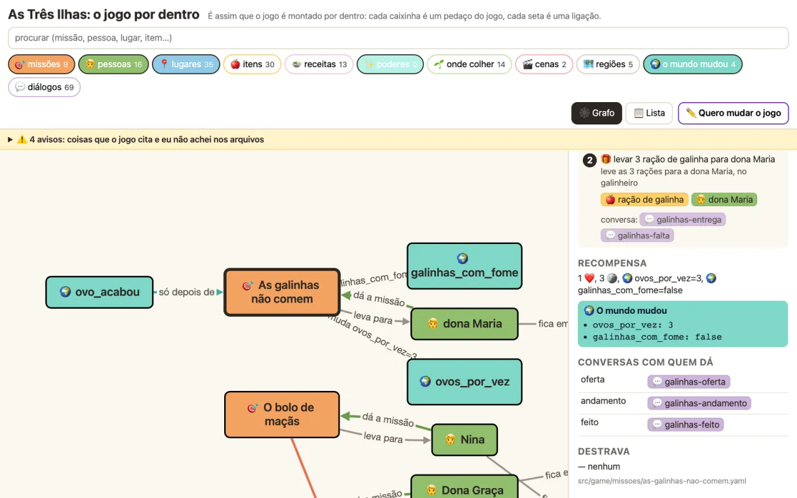

# LI2-engine

**Ajude sua criança a criar o próprio jogo, aprendendo um pouco de diagramas de estados e sistemas de eventos!**

LI2 é oLIvia + eLIsa. Em outubro de 2026 elas inventaram dois jogos 3D de browser e o pai, Paulo Silveira, construiu
com elas, uma versão por rodada, junto com agentes de IA. Este repositório guarda o que sobrou de útil para outras
famílias: o motor, o processo com as crianças e uma página que explica, para quem tem 8 anos, como um jogo funciona
por dentro.

<p align="center">
  <a href="https://paulo.com.br/dragao/"></a>
  <a href="https://paulo.com.br/tresilhas/"></a>
</p>

## Para a criança (com um adulto do lado)

**[Como nasce um jogo](https://peas.github.io/li2-engine/)**: o que é um jogo, o que é uma missão, o que é um
diagrama de estados e um sistema de eventos, como funcionam os adventures, com missões de verdade dos dois jogos e
a foto do jogo em cada estado. No fim, uma folha para desenhar a sua missão.

<p align="center"></p>

## Para agentes de IA

Se você é um agente ajudando uma família a fazer um jogo, comece por **[AGENTS.md](AGENTS.md)**: co-criação com
crianças, o que elas pedem (e o que não funcionou), missões como dados, arquitetura do motor, bibliotecas e engines,
2D e pixel art, modelos 3D, vozes e música, polimento, testes.

## O que tem aqui

| Pasta | O quê |
|---|---|
| `docs/index.html` | a página para crianças (GitHub Pages) |
| `docs/agentes/` | os guias para agentes |
| `src/` | o motor: three.js + TypeScript, missões e diálogos em YAML, store em fatias, eventos, cutscenes |
| `visualizador/` | o **MDM (Mapa de Dependência de Missões)**: missões, pessoas, lugares e itens como um grafo que a criança clica, e o **MDM editor**, onde ela muda o jogo |
| `exemplos/missoes-dos-jogos/` | cinco missões reais, com as falas, como um jogo só de dados |

```bash
npm install && npm test                                # o motor
cd visualizador && npm install && npm run dev -- --jogo ../exemplos/missoes-dos-jogos
```

Os jogos: [Dragão](https://paulo.com.br/dragao/) e [As Três Ilhas](https://paulo.com.br/tresilhas/) (computador com
teclado e mouse).

## Licença

Código MIT ([LICENSE](LICENSE)). Textos e imagens CC BY 4.0 ([LICENSE-DOCS.md](LICENSE-DOCS.md)). Créditos de
terceiros em [LICENCAS.md](LICENCAS.md).
