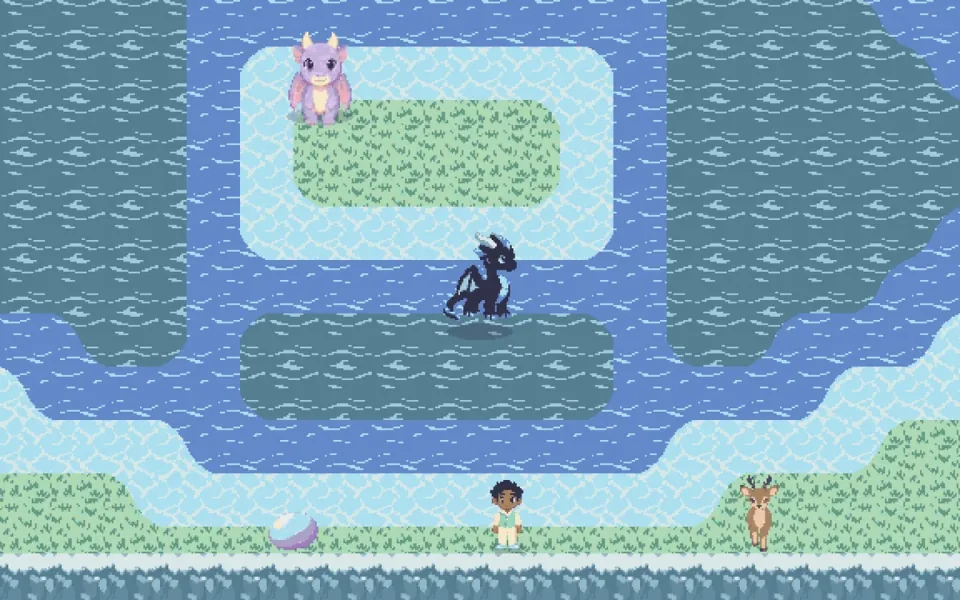
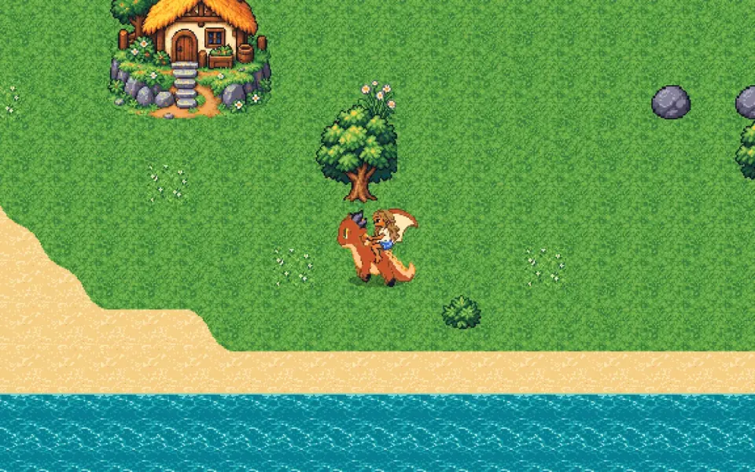

# LI2-engine

**Ajude sua criança a criar o próprio jogo, aprendendo um pouco de diagramas de estados e sistemas de eventos!**

LI2 é oLIvia + eLIsa. Em outubro de 2026 elas inventaram dois jogos 3D de browser e o pai, Paulo Silveira, construiu
com elas, uma versão por rodada, junto com agentes de IA. Depois, cada jogo ganhou também um esboço 2D em pixel art,
no estilo dos adventures de 16 bits, com as mesmas missões. Os quatro estão em **<https://paulo.com.br/jogos/>**.
Este repositório guarda o que sobrou de útil para outras famílias: o motor, o processo com as crianças e uma página
que explica, para quem tem 8 anos, como um jogo funciona por dentro.

<p align="center">
  <a href="https://paulo.com.br/dragao/"></a>
  <a href="https://paulo.com.br/tresilhas/"></a>
</p>
<p align="center">
  <a href="https://paulo.com.br/dragao2d/"></a>
  <a href="https://paulo.com.br/tresilhas2d/"></a>
</p>
<p align="center"><sub>Em cima, os jogos 3D (three.js, este motor); embaixo, os esboços 2D (Phaser, código à parte, mesmas missões).</sub></p>

## Para a criança (com um adulto do lado)

**[Como nasce um jogo](https://peas.github.io/li2-engine/)**: o que é um jogo, o que é uma missão, o que é um
diagrama de estados e um sistema de eventos, como funcionam os adventures, com missões de verdade dos dois jogos e
a foto do jogo em cada estado. No fim, uma folha para desenhar a sua missão.

<p align="center"></p>

## Para agentes de IA

Se você é um agente ajudando uma família a fazer um jogo, comece por **[AGENTS.md](AGENTS.md)**: co-criação com
crianças, o que elas pedem (e o que não funcionou), missões como dados, arquitetura do motor, bibliotecas e engines,
2D e pixel art, modelos 3D, vozes e música, polimento, testes.

O 2D não está no motor: os dois esboços são apps Phaser + GridEngine que leem os mesmos YAML de missões e diálogos dos
jogos 3D. O que se aprendeu com eles (mapa em texto, arte gerada por IA com contrato, roupas e cores em pixel art,
testes, e como publicar um jogo que tem segredos da família sem vazar nada) está em
[docs/agentes/2d-pixel-art.md](docs/agentes/2d-pixel-art.md).

## O que tem aqui

| Pasta | O quê |
|---|---|
| `docs/index.html` | a página para crianças (GitHub Pages) |
| `docs/agentes/` | os guias para agentes |
| `src/` | o motor: three.js + TypeScript, missões e diálogos em YAML, store em fatias, eventos, cutscenes |
| `visualizador/` | o **MDM (Mapa de Dependência de Missões)**: missões, pessoas, lugares e itens como um grafo que a criança clica, e o **MDM editor**, onde ela muda o jogo |
| `exemplos/missoes-dos-jogos/` | cinco missões reais, com as falas, como um jogo só de dados |

```bash
npm install && npm test                                # o motor
cd visualizador && npm install && npm run dev -- --jogo ../exemplos/missoes-dos-jogos
```

Os jogos, todos em <https://paulo.com.br/jogos/> (computador com teclado; os 3D também com mouse):

| | 3D | 2D |
|---|---|---|
| O Dragão, da Elisa | [paulo.com.br/dragao](https://paulo.com.br/dragao/) | [paulo.com.br/dragao2d](https://paulo.com.br/dragao2d/) |
| As Três Ilhas, da Olivia | [paulo.com.br/tresilhas](https://paulo.com.br/tresilhas/) | [paulo.com.br/tresilhas2d](https://paulo.com.br/tresilhas2d/) |

## Licença

Código MIT ([LICENSE](LICENSE)). Textos e imagens CC BY 4.0 ([LICENSE-DOCS.md](LICENSE-DOCS.md)). Créditos de
terceiros em [LICENCAS.md](LICENCAS.md).
