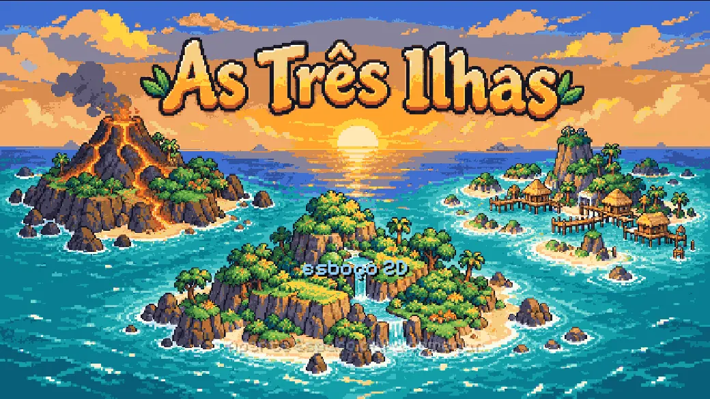
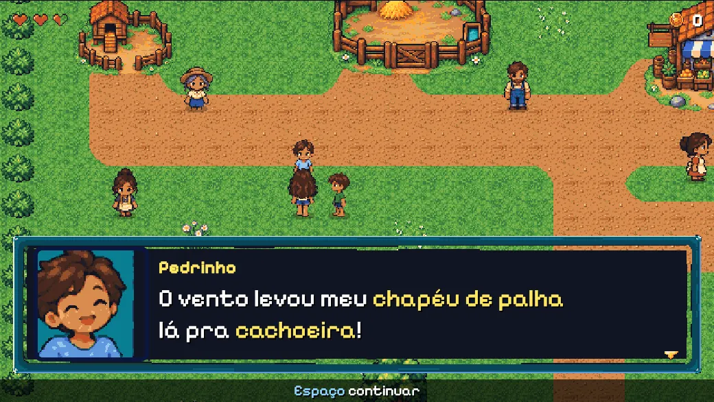
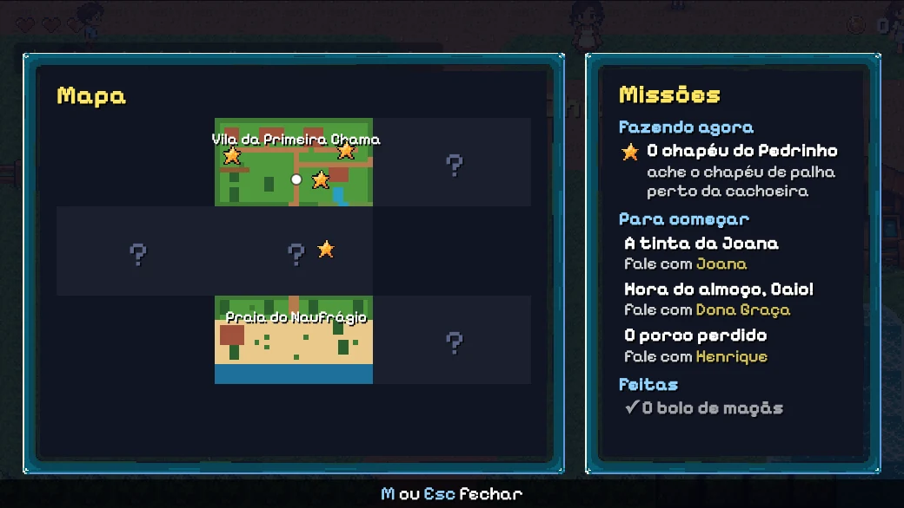
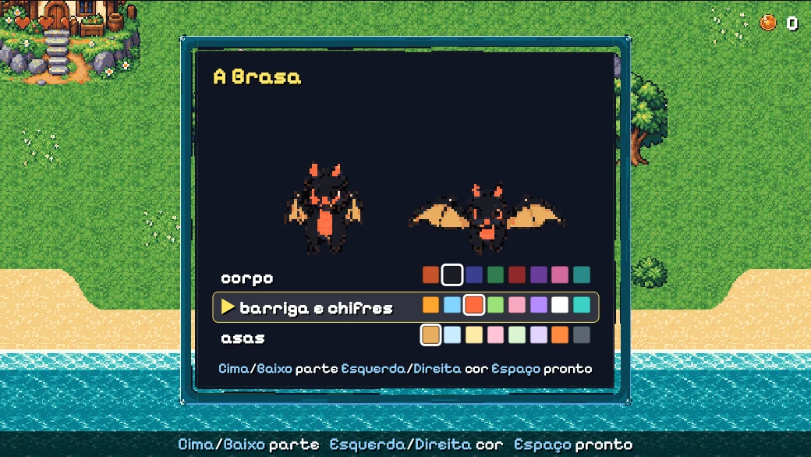
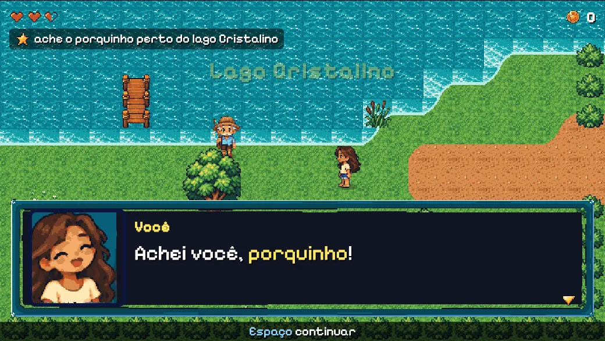
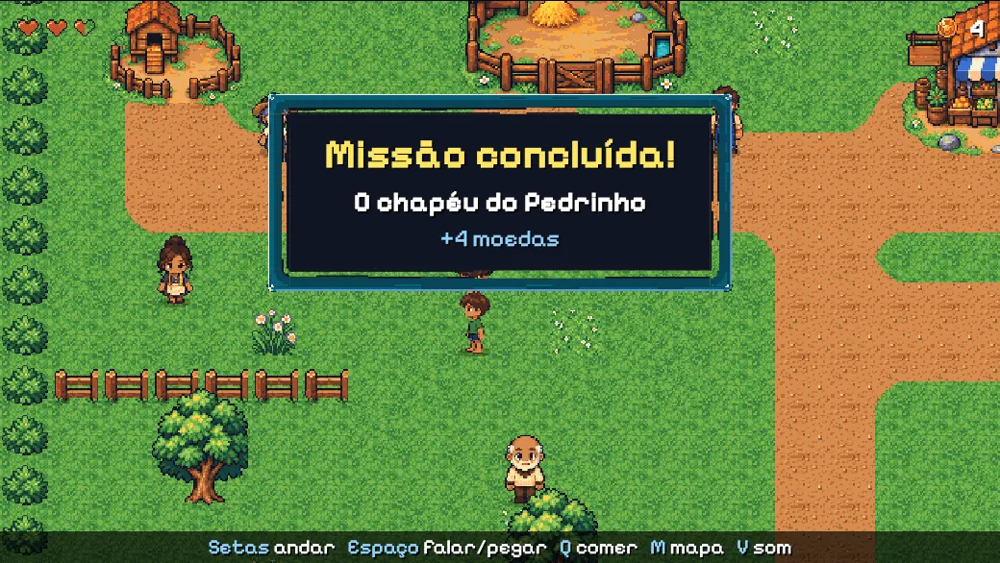

# Jogo 2D e pixel art

Para que serve: ajudar um agente a decidir se o jogo de uma família deve ser 2D em vez de 3D e, se for, como montar
sprites, animação por estados, partículas e som sem uma engine pesada. Os dois jogos deste motor são 3D (three.js),
e As Três Ilhas ganhou um **esboço 2D** em pixel art, no estilo dos adventures de 16 bits, que é o exemplo principal
deste guia (seção abaixo). O resto veio de uma página 2D de teste em canvas, da pesquisa "pixel art a partir de
fotos" (out/2026) e de um brief de adventure 2D escrito a partir das lições dos jogos 3D. A camada de conteúdo (missões, diálogos, save) é a
mesma nos dois casos: ver [arquitetura.md](arquitetura.md) e [missoes-como-dados.md](missoes-como-dados.md).

## Quando 2D é melhor

| Situação | 2D | 3D |
|---|---|---|
| A criança quer desenhar os personagens | o desenho dela vira sprite quase direto | precisa de modelo, rig e clipes ([modelos-3d.md](modelos-3d.md)) |
| Mecânica de adventure (falar, levar item, abrir porta) | cabe inteira num mapa de tiles | cabe, mas com câmera, terreno e colisão 3D |
| Exploração com voo, escala, "mundo aberto" | perde o encanto | é onde o 3D se paga |
| Tempo do adulto | menos peças: imagem, grade, estado | mais peças e mais bugs de câmera |

Regra prática: se a graça está em **ver o próprio desenho andando**, comece 2D. Se está em voar e explorar, 3D.

## O exemplo: As Três Ilhas em 2D

<p align="center">
</p>

Em outubro de 2026 o jogo da Olivia ganhou um esboço 2D, vista de cima como os adventures de Super Nintendo, para ela
e o Paulo sentirem se a ideia vale. O que ele mostra para quem vai fazer um jogo 2D com uma criança:

- **O conteúdo é o mesmo do jogo 3D.** O esboço lê os mesmos YAML de missões, diálogos, moradores e itens, validados com
  Zod, e escolhe sozinho quais missões cabem no 2D (as que só usam pessoas, lugares e itens que existem no mapa). Seis
  missões do 3D funcionam no 2D sem reescrever nada. É a prova de que [missoes-como-dados.md](missoes-como-dados.md)
  serve igual nos dois.
- **A pilha é a recomendada abaixo**: Phaser 3.90.0, tela de 640×360 (20 × 11 tiles de 32 px) ampliada por fator
  inteiro; **GridEngine** (plugin do Phaser, Apache-2.0; 2.53.0 em out/2026) para andar em grade com passo suave,
  colisão e moradores que passeiam; HUD, caixa de diálogo e menu em HTML/CSS por cima do canvas; zzfx e Web Audio no
  som; a fonte Pixelify Sans (OFL).
- **O mapa é texto**: cada área é uma grade de letras num YAML (`~` é lago, uma letra para cada coisa) com uma
  legenda. Bordas entre terrenos saem sozinhas por **Wang tiles**; árvore tem tronco embaixo da personagem e copa por
  cima. A criança pode editar o mapa e ver mudar.
- **A arte foi gerada por IA** (um gerador de imagem, a partir de um documento de pedido detalhado) e tratada com
  Pillow: recorte, redução *nearest-neighbor*, paleta fixa sem *dithering*, alfa binário, atlas. 18 pessoas com andar
  nas 4 direções e retratos em 3 expressões, bichos, cenário, interface, efeitos e cutscenes. O pedido diz o tamanho
  do quadro, as poses e as cores reservadas; o que saiu errado (uma dragoa pequena demais, uma cor trocada) vira o
  pedido seguinte. Proveniência registrada num `LICENCAS.md` da pasta da arte.
- **Trocar a cor de um bicho em pixel art** sem refazer a folha: cada parte usa tons reservados (corpo, barriga, asa) e
  o jogo troca a cor pelos próprios pixels, mantendo a sombra, e "assa" o resultado numa textura nova.
- **Testes como no 3D**: vitest para o mapa e as missões; Playwright com teclas de verdade em blocos independentes,
  com captura de tela em cada um (de onde vieram estas imagens).

<p align="center">
</p>
<p align="center">
</p>

## Sprite sheets

Uma sprite sheet é uma imagem em grade: cada **coluna** é um quadro da animação, cada **linha** é um estado (ou uma
variação). O código só calcula o retângulo de origem e desenha.

- **Tamanho do quadro**: a página de teste usa quadros de 256 × 256 px em grade 4 colunas × 5 linhas (imagem de
  1024 × 1280, WebP sem perda, entre 0,5 e 0,7 MB cada). A pesquisa sugere 128 ou 256 px para retrato e testar 64 × 64
  para corpo inteiro, aceitando menos detalhe no rosto. São propostas, não limites de ferramenta.
- **Ciclos por estado**: uma linha por estado (`parado`, `andando`, `pulando`, `falando`...), mesmo número de quadros
  por linha facilita (4 na página de teste). Estados que não cabem numa sheet vão para uma segunda (a página usa duas
  sheets por personagem, 10 estados no total).
- **Pixel limpo**: `ctx.imageSmoothingEnabled = false` no canvas e `image-rendering: pixelated` no CSS. Sem isso o
  navegador borra a escala.
- **Revisar a arte**: grade uniforme, paleta curta, contorno consistente. Imagem "com cara de pixelada" não garante pixel
  art tecnicamente limpa (pesquisa, out/2026).

## Aseprite

Editor de sprites com camadas, quadros, paletas e exportação. Tem CLI: `--batch` roda sem abrir a interface e scripts
Lua automatizam criação e edição, então um agente consegue exportar sem clicar. Exige o executável instalado. A
licença é uma EULA própria: não assumir licença permissiva só porque o código está no GitHub.

Export típico de sheet + JSON (conferir as opções em https://www.aseprite.org/docs/cli/):

```sh
aseprite --batch personagem.aseprite \
  --sheet public/sprites/personagem.png --data public/sprites/personagem.json \
  --format json-array --sheet-type rows --list-tags
```

As **tags** do Aseprite (intervalos de quadros nomeados) viram os estados no JSON: o jogo lê `frameTags` e não precisa
de tabela escrita à mão. Não vale compilar o Aseprite antes do primeiro teste: custo de preparo sem ganho (pesquisa).

## Geradores de imagem e PixelLab

| Ferramenta | Bom para | Limites (out/2026) |
|---|---|---|
| Gerador de imagem com referência | primeiro retrato do personagem, conferir semelhança | qualidade não testada em benchmark; tende a perder consistência entre imagens |
| PixelLab | sequência de sprites de jogo: imagem → pixel art, geração por referência, rotações, animações; API HTTP, SDK Python, MCP remoto, integração com Aseprite | API exige token, MCP exige assinatura ativa; preço não verificado; gera na nuvem; superioridade na semelhança de rosto não demonstrada |
| Reduzir resolução e cores de uma foto | nada | dá uma foto pixelizada, não um personagem com direção de arte |

Fluxo recomendado pela pesquisa: (1) gerar um retrato estático com referência, em composição e estilo fixos; (2)
avaliar semelhança antes de animar; (3) PixelLab se precisar de várias direções e animações; (4) Aseprite para
acabamento, camadas e export.

**Consistência de personagem**: aprove um desenho-mestre e gere tudo a partir dele (mesma referência, mesmo estilo,
mesma paleta). Gerar cada estado do zero produz personagens diferentes.

**Foto de gente de verdade**: mandar a foto de uma pessoa real para um serviço na nuvem é decisão do adulto. Escolha
referências apropriadas antes de mandar qualquer coisa para fora; desenho da criança ou foto dela não vai para repo
público.

## Um sprite é uma pequena máquina de estados

É o mesmo diagrama de estados que a criança desenha para as missões: bolinhas (estados) e setas (eventos). Para o
sprite, cada estado diz **qual linha** da sheet tocar, **quantos quadros por segundo**, se faz **loop** e **para onde
vai** quando acaba.

```ts
type Estado = "parado" | "andando" | "pulando" | "pousando";
const ESTADOS: Record<Estado, { linha: number; quadros: number; fps: number; loop: boolean; depois?: Estado }> = {
  parado:   { linha: 0, quadros: 4, fps: 4,  loop: true },
  andando:  { linha: 1, quadros: 4, fps: 8,  loop: true },
  pulando:  { linha: 2, quadros: 4, fps: 10, loop: false, depois: "pousando" },
  pousando: { linha: 3, quadros: 4, fps: 12, loop: false, depois: "parado" },
};
// Transições por evento: só a tabela muda quando a criança pede um estado novo.
const TRANSICOES: Partial<Record<Estado, Partial<Record<"mover" | "parar" | "pular", Estado>>>> = {
  parado:  { mover: "andando", pular: "pulando" },
  andando: { parar: "parado",  pular: "pulando" },
};
function desenhar(ctx: CanvasRenderingContext2D, sheet: HTMLImageElement, e: Estado, t: number, x: number, y: number, Q = 256) {
  const s = ESTADOS[e], f = s.loop ? Math.floor(t * s.fps) % s.quadros : Math.min(s.quadros - 1, Math.floor(t * s.fps));
  ctx.drawImage(sheet, f * Q, s.linha * Q, Q, Q, x, y, Q, Q);
}
```

`t` é o tempo desde a entrada no estado; ao terminar um estado sem loop, vá para `depois`. Desenhe a tabela com a
criança antes de codar: ela vira o YAML ou o objeto acima quase linha a linha.

## A técnica da página 2D de teste em canvas

Canvas puro, sem biblioteca, um `requestAnimationFrame` só. O que vale copiar:

1. **Carregar tudo antes de animar**: `Promise.all` das sheets; só então começa o loop. Se uma falhar, troca a área do
   jogo por uma mensagem curta ("recarregue a página") em vez de ficar em branco.
2. **Quadro pelo relógio**: `quadro = Math.floor(agora / 260) % 4` (cerca de 4 quadros por segundo, ritmo de pixel art).
   Linha = estado atual; a sheet certa sai do índice do estado.
3. **Troca de estado escondida por fumaça**: um clique dispara 35 partículas e a troca de linha acontece em 230 ms,
   quando a fumaça já cobre o personagem; o efeito dura 700 ms e cliques durante ele são ignorados (trava).
4. **Fumaça procedural em pixel**: partículas numa grade 7 × 5 sobre o personagem, cada uma com deriva horizontal
   aleatória e subida; tamanho pulsa com `sin(π·t)`; posição e tamanho **arredondados a múltiplos de 4 px** (o "pixel
   grosso" da arte); cada nuvem são dois `fillRect` em cruz (cantos cortados, parece bolinha pixelada); três tons claros
   alternados; opacidade sobe rápido no primeiro terço e cai devagar.
5. **Web Audio sintetizado, sem arquivo**: o `AudioContext` nasce no primeiro clique (`audio ??= new AudioContext();
   audio.resume()`). O "puf" são duas camadas: um oscilador triangular que sobe de 180 a 850 Hz em 0,12 s e desce a
   280 Hz em 0,38 s, com ganho 0,09 caindo exponencialmente; mais 0,22 s de ruído branco num `AudioBuffer` com envelope
   decrescente, ganho 0,045. Tudo dentro de `try/catch`: sem áudio, o jogo segue.
6. **`prefers-reduced-motion`**: sem ciclo de quadros e sem fumaça; a troca é imediata.
7. **Cenário independente do personagem**: duas camadas `` alternando (double buffer), todas pré-carregadas, cada
   troca espera `image.decode()` antes de mostrar; um contador de pedidos faz cliques rápidos aplicarem só o último; se
   uma imagem falha, mostra aviso e o próximo clique segue.
8. **Acessibilidade**: o personagem é um `<button>` com `aria-label` atualizado a cada troca ("versão 3 de 10").

## Fumaça e partículas em geral

- Partícula = `{x, y, dx, dy, tamanho, vida}`; atualize por `t = idade / duração` e desenhe com `fillRect` alinhado à
  grade. Sem textura, sem biblioteca.
- Use para esconder troca (estado, roupa, cenário), para "+1" ao pegar item e para poeira ao pousar (6 a 12 partículas
  na cor do chão, ver [polimento.md](polimento.md)).
- Nada piscando mais de 3 vezes por segundo.

## Web Audio simples

- Um `AudioContext` só, criado no primeiro gesto (`pointerdown`/`keydown`); antes disso, tudo mudo e nada lança erro.
- Efeitos curtos por código: zzfx (o motor tem `Sfx` em `src/audio/sfx.ts`) ou oscilador + ruído como acima.
- Música e vozes: [vozes-e-musica.md](vozes-e-musica.md).

## Pilha 2D recomendada

Esta é a pilha que o Paulo usa hoje num outro jogo 2D, que já funcionou na prática. É a recomendação padrão para uma
família começando um jogo 2D. Versões conferidas no npm em 24/10/2026.

| Peça | Versão | Para quê |
|---|---|---|
| Phaser | 3.90.0 | motor do jogo: cenas, sprites e animações, câmera, input, tilemap, colisão simples |
| TypeScript | 5.9.3 | código (a 7.0 já saiu; a 5.9 é a que foi usada) |
| Vite | 8.3.5 | servidor de desenvolvimento e build |
| Zod | 4.6.7 | validação do conteúdo (história, falas, missões) ao carregar |
| Vitest | 5.0.5 | testes da lógica |
| Web Audio API | do navegador | efeitos sonoros (ou zzfx, abaixo) |
| HTML/CSS + Canvas | do navegador | interface por cima do jogo e retratos dos personagens |
| JSON + localStorage | do navegador | a história editável e o progresso (o save) |
| YouTube IFrame API | do navegador | música com crossfade (veja o cuidado abaixo) |

O que **não** entrou e não fez falta: React, Ink, Tiled. O sistema de diálogos é próprio (caixa em HTML com retrato,
texto letra a letra e as regras de [polimento.md](polimento.md)). A história em JSON validada por Zod é a mesma ideia
das missões e diálogos em YAML deste motor: conteúdo em dados com schema serve igual em 2D e em 3D, e o formato de
[missoes-como-dados.md](missoes-como-dados.md) pode ser copiado como está.

**Cuidado com a música pelo YouTube.** Funciona bem num jogo pessoal, mas a música do vídeo continua com a licença de
quem a publicou, o vídeo pode sumir ou deixar de permitir incorporação, e a API tem termos próprios para o player numa
página pública. Num jogo publicado, troque por arquivos de música CC BY tocados com Web Audio (`fetch` +
`decodeAudioData`, dois `GainNode` para o crossfade), com o crédito na tela do jogo
([vozes-e-musica.md](vozes-e-musica.md) tem fontes e o formato do crédito).

### Se precisar de X, use Y

Situação em 24/10/2026 ("viva" = release nos últimos 12 meses).

| Se precisar de... | Use | Situação |
|---|---|---|
| começar um jogo novo no Phaser | Phaser 4 (estável desde a 4.0.0, abril de 2026; hoje 4.2.1) | vivo. A 3.90.0 (maio de 2025) é a última da linha 3 e continua funcionando; para jogo novo, avalie a 4 antes. Não testada nestes jogos |
| algo menor que o Phaser | Kaplay (3001.0.19, maio de 2026; a 4000 está em alpha) | vivo; não testado aqui |
| só desenhar rápido e manter o seu próprio loop, input e conteúdo | PixiJS (8.22.0, outubro de 2026) | vivo. É a opção do brief abaixo quando o jogo vai crescer com missões, cutscenes e testes |
| um motor 2D completo em TypeScript, com física e cenas | Excalibur (0.32.0, dezembro de 2025) | vivo; não testado aqui |
| um motor minúsculo para jogos de uma tela ou game jam | LittleJS (1.28.0, outubro de 2026) | vivo; não testado aqui |
| um protótipo de uma tela com poucos sprites | Canvas puro | sem dependência; dá para migrar depois |
| um mapa grande, montado por tiles, com portas e NPCs como objetos nomeados | Tiled (1.12.2, maio de 2026; o Phaser lê o JSON dele) | vivo |
| o mesmo, com um editor mais guiado por níveis | LDtk | o código recebe commits (outubro de 2026), mas a última release é a 1.5.3, de janeiro de 2024 |
| desenhar e animar os sprites | Aseprite (1.3.18.6, setembro de 2026) | vivo; seções acima |
| sprites a partir de um desenho ou foto | PixelLab e geradores de imagem | seções acima |
| efeitos sonoros sem arquivo | zzfx (1.4.0, outubro de 2026) | vivo; o motor usa (`src/audio/sfx.ts`) |
| tocar arquivos de som com uma API simples | Howler.js (2.2.4) | sem release desde setembro de 2023: Web Audio direto resolve o mesmo |
| estado e save maiores que um JSON solto | zustand (vanilla) + Zod, como neste motor | ver [arquitetura.md](arquitetura.md) |
| eventos ("aconteceu!") entre partes do jogo | nanoevents, como neste motor | ver [bibliotecas.md](bibliotecas.md) |

## Arquitetura sugerida para um adventure 2D

Versão do brief, para um adventure simples (falar para liberar porta, levar item, mapa pequeno com casas):

1. **Conteúdo em dados desde o dia 1**: personagens, diálogos (um arquivo por conversa: `personagem`, `retrato`,
   `falas[]`), missões, itens, lugares e portas em YAML ou JSON validado por zod. Nada de texto no código.
2. **Missões como passos tipados** (`ir`, `falar`, `coletar`, `levar`, `achar`, `abrir`) num motor pequeno com registro
   de tipos; o save guarda só `{passo, contadores, concluida}` por missão. Tipo novo = um `case`
   ([missoes-como-dados.md](missoes-como-dados.md)).
3. **Um store** (zustand/vanilla) que é o próprio save, versionado, com migrações; salvar em momentos seguros. Eventos
   tipados (nanoevents) para "o que aconteceu"; o store diz "como está".
4. **Pilha de contextos de input** (`jogo | dialogo | menu | cutscene`): só o topo recebe teclas, Esc fecha o topo.
   Registro de interações ("chegue perto e aperte E") com prioridade, em vez de if/else no loop.
5. **Render**: Phaser (a pilha recomendada acima) ou PixiJS sobre um loop próprio. Mapas no Tiled ou LDtk com portas, NPCs e lugares como objetos
   nomeados ligados aos ids do YAML; colisão em grade de tiles, sem física. Telas (mochila, missões, ajuda) em preact;
   HUD em HTML/CSS sobre o canvas.
6. **Diálogo**: palavras-chave em até duas cores, texto letra a letra com blip por letra e pausa em vírgula e ponto
   (120 ms e 350 ms), a fala nunca avança sozinha, retrato e nome, no máximo 2 linhas de ~38 caracteres.
7. **Cutscenes como roteiro em dados** (`camera`, `mover`, `fala`, `esperar`, `som`, `fade`...), pular segurando Esc;
   em 2D, câmera nomeada = pan e zoom ([cutscenes.md](cutscenes.md)).
8. **Tudo explicado no jogo**: barra de teclas do contexto, dica na primeira vez, aviso de "ainda não pode" com o
   motivo, tela de ajuda.
9. **Polimento barato**: som em toda ação, "+1" subindo, fanfarra curta ao concluir missão, música por região com
   crossfade. Nada de morte, game over ou timer punitivo ([polimento.md](polimento.md)).
10. **Um MDM, Mapa de Dependência de Missões** (grafo de missões, pessoas, itens) lendo os mesmos YAML, e um teste que cruza todos os
    ids, para erro de digitação falhar no `npm test` e não na frente da criança ([testes.md](testes.md)).
11. **Processo com a criança**: uma novidade grande por versão, bug que ela viu antes de qualquer novidade
    ([co-criacao.md](co-criacao.md)).
12. **Testes**: vitest para a lógica e um teste de ponta a ponta no Chromium headless que visita cada lugar e cumpre
    cada missão.

Não usar: Lua embutido, Yarn Spinner em JS, Theatre.js, engines de visual novel, ECS genérico.

## Fontes

- Pesquisa "Pixel art a partir de fotos: Aseprite, geração de imagem e PixelLab" (22/10/2026)
- Notas técnicas e código da página 2D de teste em canvas (22 e 23/10/2026)
- Brief "adventure 2D simples com sprites" (23/10/2026)
- https://github.com/aseprite/aseprite/blob/main/README.md
- https://www.aseprite.org/docs/cli/
- https://www.pixellab.ai/docs/ways-to-use-pixellab
- https://www.pixellab.ai/docs/tools/image-to-pixel-art
- https://api.pixellab.ai/v2/docs
- Pilha 2D em uso pelo Paulo num jogo pessoal (informada em 24/10/2026)
- O esboço 2D das Três Ilhas (24/10/2026): README, registro de licenças da arte e capturas do próprio esboço
- https://www.npmjs.com/package/grid-engine
- Versões e datas conferidas em 24/10/2026: https://www.npmjs.com/package/phaser, https://www.npmjs.com/package/kaplay,
  https://www.npmjs.com/package/pixi.js, https://www.npmjs.com/package/excalibur, https://www.npmjs.com/package/littlejsengine,
  https://www.npmjs.com/package/zzfx, https://www.npmjs.com/package/howler, https://github.com/mapeditor/tiled/releases,
  https://github.com/deepnight/ldtk/releases, https://github.com/aseprite/aseprite/releases
