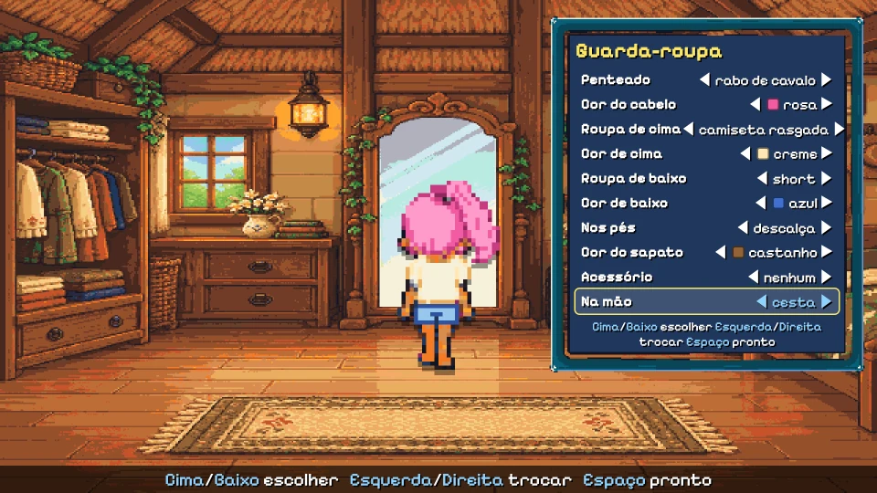
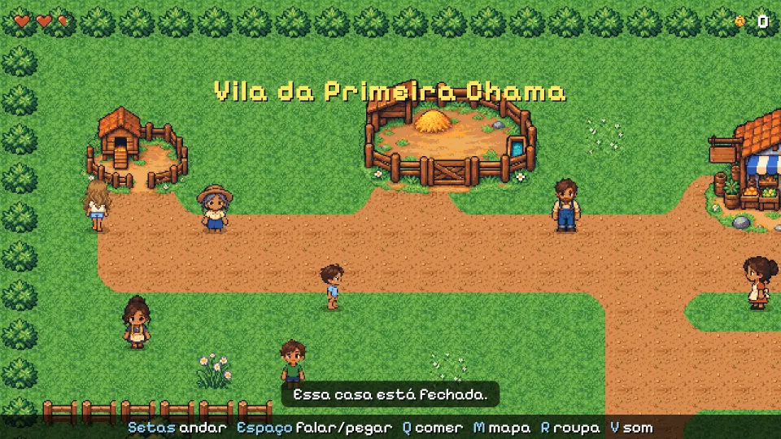
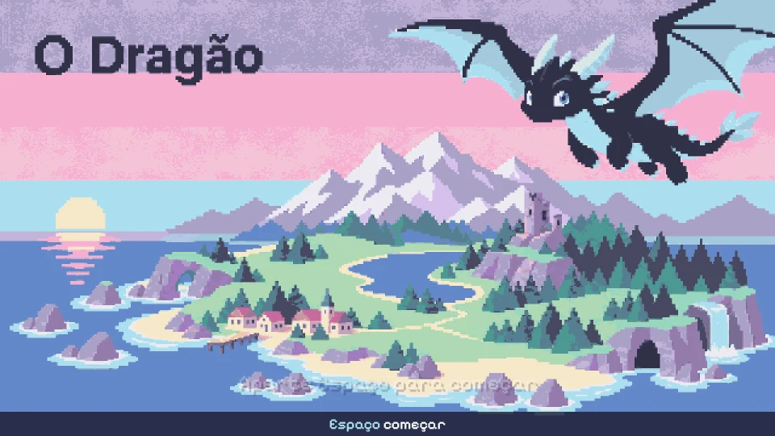
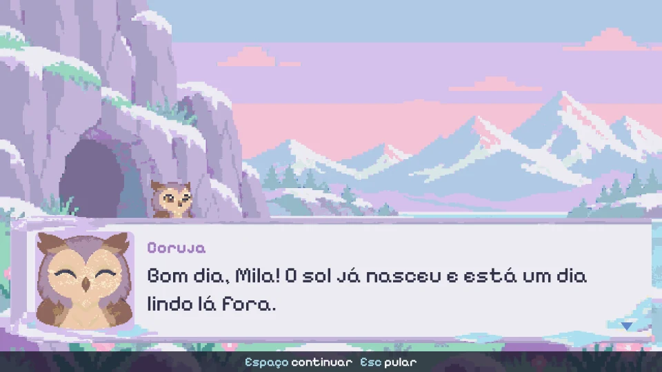
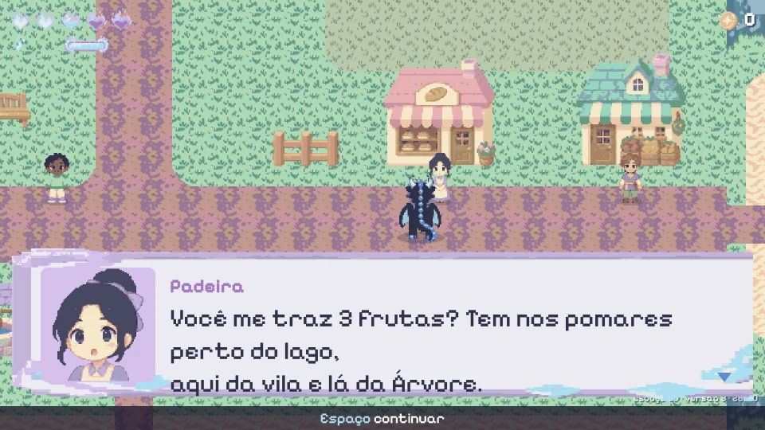
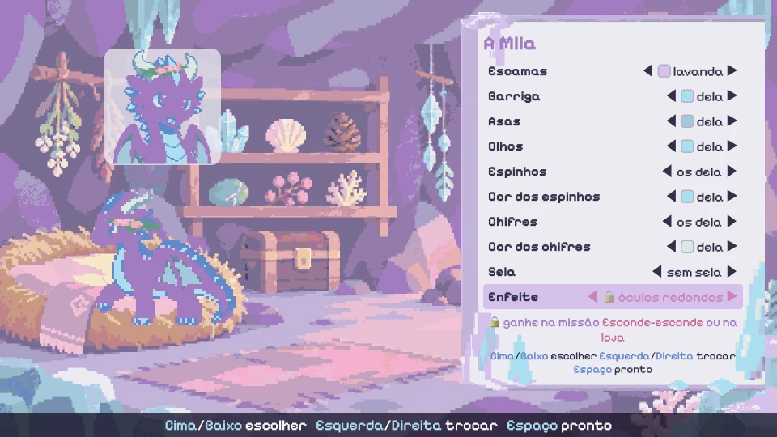
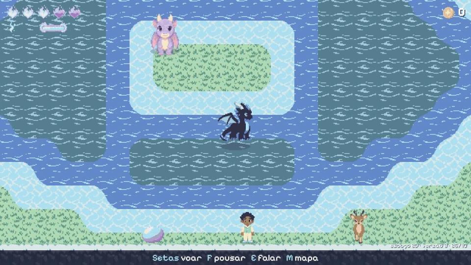

# Jogo 2D e pixel art

Para que serve: ajudar um agente a decidir se o jogo de uma família deve ser 2D em vez de 3D e, se for, como montá-lo:
pilha, mapa, andar em grade, arte gerada com contrato, roupas e cores em pixel art, testes e como publicar sem vazar
nada da família. Os dois jogos deste motor nasceram 3D (three.js) e, em outubro de 2026, **os dois ganharam um esboço
2D** no estilo dos adventures de 16 bits (vista de cima, pixel art, caixa de diálogo com retrato). Os dois estão no ar
desde 28/10/2026, junto com os jogos 3D, em <https://paulo.com.br/jogos/>:

| Jogo | 3D | 2D |
|---|---|---|
| O Dragão (da Elisa) | <https://paulo.com.br/dragao/> | <https://paulo.com.br/dragao2d/> |
| As Três Ilhas (da Olivia) | <https://paulo.com.br/tresilhas/> | <https://paulo.com.br/tresilhas2d/> |

**O código 2D não faz parte deste motor.** Ele mora numa pasta `esboco-2d/` do repositório (privado) de cada jogo, é
um app Phaser à parte e não importa nada de `src/` daqui. O que vem deste repositório para o 2D é o **formato do
conteúdo** (missões, diálogos, itens em YAML, [missoes-como-dados.md](missoes-como-dados.md)) e o que está escrito
abaixo. O que uma família pode reaproveitar: a pilha e as versões, o mapa em texto, os cuidados com o andar em grade,
o contrato de arte com um gerador de imagem, a técnica de roupas e cores, a bateria de testes e o jeito de publicar.

## Quando 2D é melhor

| Situação | 2D | 3D |
|---|---|---|
| A criança quer desenhar os personagens | o desenho dela vira sprite quase direto | precisa de modelo, rig e clipes ([modelos-3d.md](modelos-3d.md)) |
| Mecânica de adventure (falar, levar item, abrir porta) | cabe inteira num mapa de tiles | cabe, mas com câmera, terreno e colisão 3D |
| Exploração com voo, escala, "mundo aberto" | perde o encanto (voar vira passar por cima da água) | é onde o 3D se paga |
| Tempo do adulto | menos peças: imagem, grade, estado | mais peças e mais bugs de câmera |
| Arte | o maior custo, mas um gerador de imagem com um bom pedido entrega uma ilha inteira em um dia (abaixo) | modelos prontos de terceiros resolvem o começo |

Regra prática: se a graça está em **ver o próprio desenho andando**, comece 2D. Se está em voar e explorar, 3D. Se o
conteúdo já está em dados, dá para ter os dois e deixar a criança dizer, sem induzir, qual quer continuar.

## O que foi feito: dois esboços 2D

### As Três Ilhas em 2D

<p align="center">
</p>
<p align="center">
</p>

Seis áreas da primeira ilha em grade, com a câmera deslizando entre elas como no Zelda; 11 moradores, alguns
passeando; **seis missões do jogo 3D valendo ao mesmo tempo**; colher, mochila, corações e moedas; o mapa ilustrado
(tecla M) com nuvem sobre o que ainda não foi visitado e estrelas onde cada missão aponta; a dragoa Brasa, com painel de
cores e montaria; e um **guarda-roupa** (penteado, cor do cabelo, roupas, sapatos, acessório e algo na mão), que vale
para o andar, as poses de ação, o retrato da caixa de diálogo e a menina montada.

<p align="center">
</p>
<p align="center">
</p>

### O Dragão em 2D

<p align="center">
</p>
<p align="center">
</p>

Nasceu do código das Três Ilhas (cópia, não biblioteca) com uma arte de estilo próprio: paleta fria e pastel, sem
contorno escuro, escolhida pelo adulto numa folha com três direções. Tem abertura (a Mila acorda, a coruja chega e diz
as falas da `abertura.yaml` do 3D), **voo baixo** que passa por cima do lago (nunca do mar), comer, dormir, rugir,
pescar, caçar segurando uma tecla (toque curto é carinho), a loja do vendedor com os preços do 3D, a tela de aparência
da Mila com peças que **se ganham terminando missões**, **nove missões do 3D** ao mesmo tempo, save automático, tela
"como jogar" (H) e a versão sempre à vista.

<p align="center"></p>

## O conteúdo é o mesmo do 3D

Os dois esboços leem os arquivos do jogo 3D **direto da pasta dele, sem cópia**: missões, diálogos, moradores, itens,
vozes (o tom do "blip" de cada personagem) e, no Dragão, a loja. Tudo validado com Zod ao carregar, por uma cópia
enxuta dos schemas do motor (os mesmos campos e ids, só o que o 2D usa). O que é só do 2D fica numa pasta `conteudo/` do esboço:

- `mapa.yaml`: as áreas em texto, uma letra por tile, com uma legenda;
- `esboco.yaml`: barra de teclas, pensamentos da protagonista, textos das telas, a ajuda, as versões.

**O esboço escolhe sozinho quais missões cabem no 2D**: uma função `jogaveis` aceita a missão só se quem pede, cada
pessoa, lugar e item dos passos existe no mapa e cada tipo de passo é um que o 2D sabe fazer, e o mesmo vale para as
missões que ela requer. O resto fica de fora sem erro:

```ts
export function jogaveis(defs: Missao[], mundo: Mundo): Missao[] {
  const ok = (d: Missao): boolean => mundo.npcs.has(d.quem) && d.passos.every((p) => {
    if (p.tipo === "falar") return mundo.npcs.has(p.npc);
    if (p.tipo === "levar") return mundo.npcs.has(p.npc) && mundo.itens.has(p.item);
    if (p.tipo === "coletar") return mundo.itens.has(p.item);
    if (p.tipo === "ir") return p.lugares.every((l) => mundo.lugares.has(l));
    return false; // tipo de passo que o 2D ainda não tem
  }) && (d.requer ?? []).every((r) => { const q = defs.find((x) => x.id === r); return !!q && ok(q); });
  return defs.filter(ok);
}
```

É a prova de que escrever as missões como dados se paga: o segundo "motor de desenho" custou um mapa e um
interpretador pequeno, não uma reescrita das missões. Uma missão nova escrita para o 3D aparece no 2D sozinha quando
tudo o que ela usa existe lá.

## A pilha usada

Versões dos dois esboços (out/2026):

| Peça | Versão | Para quê |
|---|---|---|
| Phaser | 3.90.0 | cena, sprites e animações, câmera, input, texturas de canvas |
| GridEngine | 2.48.2 (a mais nova é 2.53.0) | plugin do Phaser: andar em grade com passo suave, colisão, moradores que passeiam e bloqueiam |
| TypeScript | 5.9.3 | código |
| Vite | 8.3.5 | dev server e build |
| Zod | 4.6.7 | valida o YAML do jogo 3D e o do esboço |
| js-yaml | 5.5.0 | lê o YAML |
| zzfx | 1.4.0 | efeitos sonoros sem arquivo, mais uma melodia própria em Web Audio |
| Pixelify Sans | 5.3.0 (@fontsource, OFL) | a fonte de pixel |
| Vitest | 5.0.5 | testes da lógica |
| Playwright | o já instalado na máquina | o teste de ponta a ponta no Chromium headless |

Tela de **640 × 360** (20 × 11 tiles de 32 px), ampliada por fator inteiro, `pixelArt: true` e `roundPixels: true` no
Phaser e `image-rendering: pixelated` no CSS. HUD, caixa de diálogo, menus e telas em **HTML e CSS por cima do
canvas**: é mais fácil de escrever, testar e deixar acessível do que interface desenhada no Phaser. Não entraram e não
fizeram falta: React, Tiled, física, store externo (o estado do esboço é pequeno e mora na cena e num save de
`localStorage`).

Tamanho: o Três Ilhas 2D tem ~2.500 linhas de TypeScript e o Dragão 2D ~2.900, com testes. Mapa, missões e cena
somavam ~770 linhas na primeira versão jogável.

## O mapa é texto

Cada área é uma grade de letras num YAML, com uma legenda do que é cada letra. Uma função pura (sem Phaser, testável
no vitest) monta as camadas:

- **chão com bordas automáticas por Wang tiles**: o lago é só `~` na grama, e a borda certa sai da vizinhança; no
  Dragão, três profundidades de lago (`~`, `-`, `=`) e paredões de pedra no mesmo esquema;
- **figuras do cenário** do tamanho que a arte veio, ordenadas com os personagens pela base (y-sort): árvore tem
  tronco embaixo da personagem e copa por cima;
- o que bloqueia, o que anima, o que se colhe.

As áreas formam uma grade (3 × 2) e a câmera desliza de uma para a outra ao cruzar a borda. Duas lições: **só um passo
de verdade troca de área** (um empurrão contra a borda não), e a troca de área precisa de um destrave se a animação
não terminar, senão o jogo congela. A criança consegue editar o mapa e ver mudar; um teste confere que as bordas que
ligam as áreas casam.

## Andar em grade com GridEngine

O GridEngine resolve passo suave, colisão por tile e moradores que passeiam. O que custou caro:

- **Soltar a seta dava um passo a mais.** O update do GridEngine roda antes do da cena e guarda o movimento pedido no
  quadro anterior; soltando a tecla bem no fim de um passo, ele andava mais um tile. A correção: ao soltar a última
  seta, cancelar o movimento guardado (`gridEngine.move(id, Direction.NONE)`), e não tratar o auto-repeat do teclado
  (`e.repeat`) como pedido novo. O teste de regressão solta a tecla em 16 fases diferentes de um passo, inclusive logo
  depois de um auto-repeat.
- **Toque mais curto que um quadro** ainda pede um passo: guardar o pedido no `keydown` e consumir no update.
- **Colisão que muda com o estado**: voando, os tiles do lago deixam de bloquear só para a protagonista (a
  propriedade de colisão dos tiles é trocada ao decolar e ao pousar, e os bichos param de passear enquanto ela voa); o
  mar bloqueia sempre, e ela não pousa na água.
- **Personagem maior que o tile** (a dragoa de 64 × 64 num tile de 32) ocupa um tile só, centrada nele.
- **Ação só parada**: falar, colher e abrir só valem com a protagonista fora de movimento. E um Espaço que fecha a
  conversa não pode virar compra: a loja só escuta depois de meio segundo aberta.

## Arte gerada por IA, com contrato

Toda a arte dos dois esboços foi gerada pelo Codex (o agente da OpenAI, com geração de imagem) a partir de um
**pedido escrito**, e validada por ele antes de entregar. Num dia vieram 237 arquivos coerentes para a primeira ilha
(depois 242 PNGs num jogo e 311 no outro). O custo que sobra não é desenhar, é **consistência e encaixe**: casas
modulares que não fecham, borda de água que não casa com o chão, a mesma pessoa diferente em cada pose.

O que funcionou:

1. **Primeiro uma folha-mestra** (e, no Dragão, uma folha com três direções de estilo para o adulto escolher). Só
   depois de aprovada, o pedido completo.
2. **O pedido é um documento**: tamanho do tile (32 × 32), das pessoas (32 × 48, 12 quadros de andar), dos retratos
   (96 × 96, várias expressões), a lista inteira de arquivos com tamanhos exatos, as cores reservadas, a ordem das
   camadas, "não pare no meio" e um relatório retomável.
3. **A entrega é um contrato**: uma pasta por versão (v1, v2...), um `manifesto.json` (cada PNG, dimensões, quadros,
   nomes das animações, fps), um `validacao.json` com `ok: true`, um `fim.txt` que marca o fim (o importador espera por
   ele), prévias e um `IMPORTAR.txt` com o que mudou. Um script `importar-arte` copia para o jogo só os arquivos de
   jogo, com `--limpar` para trocar a versão inteira.
4. **O que saiu errado vira o pedido seguinte**: a dragoa pequena demais (a v3 trouxe do tamanho de um cavalo), o kit de
   casinha que não encaixava (virou casas prontas), itens de mão do tamanho das pernas (pedido de 14 a 16 px).
5. **Revisar cada entrega com o adulto**: o gerador acrescenta coisas por conta própria (traços de personagem que
   ninguém pediu). Isso é decisão da família e da criança, não do agente.
6. **Proveniência** num `LICENCAS.md` da pasta da arte: ferramenta, data, o que foi pedido.

O que guardar fora do git: qualquer referência pessoal usada no pedido (foto, desenho da criança). Ver "Foto de gente de
verdade" abaixo.

## Roupas, cores e acessórios em pixel art

Três técnicas, que se combinam:

| Técnica | O que troca | Custo de arte | Custo de código |
|---|---|---|---|
| **Troca de paleta** | a cor de uma parte (cabelo, camiseta, escamas) | nenhum por cor nova: a parte é pintada uma vez com uma **rampa-chave** de 4 tons reservados, e o jogo troca esses tons por outra rampa | pequeno: trocar pixels num canvas |
| **Camadas alinhadas** ("paper doll") | peças inteiras (vestido no lugar do short, outro penteado, outros chifres) | cada peça desenhada em **todos** os quadros da folha, na mesma grade do corpo | pequeno: empilhar num canvas |
| **Acessório por cima** | chapéu, laço, óculos, sela | igual às camadas | o mesmo |

O que os esboços fazem:

- **Assar, não empilhar.** O jogo junta corpo, roupa, cabelo e acessório num canvas e gera **uma** folha de sprites
  (`textures.addSpriteSheet`), que o GridEngine anima como sempre. Empilhar sprites que andam juntos dá quadro
  dessincronizado e briga de profundidade; assar é feito uma vez por troca de roupa. O retrato da caixa de diálogo e a
  pose montada são assados do mesmo jeito.
- **Rampas-chave exclusivas**: cada parte recolorível usa 4 cores que não aparecem em mais nada (`rampas.json`), e as
  opções da criança são outras rampas (`rampas-opcoes.json`). Se a cor de uma parte aparecer noutra, as duas mudam
  juntas: o pedido de arte precisa avisar o gerador.
- **Sem rampa-chave, as cores do próprio sprite**: a primeira dragoa trocava de cor pela própria paleta (26 cores),
  com máscaras por anatomia dizendo o que é corpo, barriga ou asa; a cor escolhida substitui a cor-base e os outros
  tons seguem com a mesma diferença de luz, então a sombra fica. Tingir (`setTint`, que multiplica) deixa a cor chapada.
- **Metades atrás e na frente** para capa, mochila, cachecol, sela: com elas a ordem das camadas é **a mesma em todas
  as direções**, sem regra especial no código.
- **Âncoras em JSON** (mão, alto da cabeça, quadril em cada quadro): o item na mão é um sprite que segue a âncora, atrás
  ou na frente do corpo (assado, ele era cortado na borda do quadro); o item achado sobe acima da cabeça, como nos
  adventures antigos; a menina montada encaixa no quadril de cada quadro da dragoa.
- **Peças que se ganham** (Dragão): duas ou três de cada tipo já vêm livres, o resto se ganha terminando missões ou na
  loja; o que está trancado mostra um cadeado e diz onde se ganha, e o carimbo de missão concluída avisa o que ficou
  novo. A lista é dado (`livres`, `ganhar` no YAML do esboço).

## Interface e "tudo explicado"

As regras de [polimento.md](polimento.md) valem iguais no 2D:

- caixa de diálogo com retrato e nome, texto letra a letra com o blip da voz de cada um; o YAML do 3D não tem
  expressões, então a expressão do retrato sai da pontuação da fala (`!` feliz, `?` ou `...` surpresa);
- barra de teclas do contexto, sempre embaixo; tela "como jogar" (H) gerada do YAML, com o que é novo na versão;
- **porta que abre tem uma setinha** balançando quando a protagonista chega perto; esbarrar numa casa que não abre
  mostra "Essa casa está fechada" (no máximo a cada 4 s);
- **versão sempre à vista** ("esboço 2D · versão N · dd/mm"), da entrada mais nova da lista de versões;
- **save automático** no `localStorage` a cada 3 s e ao fechar a aba; o título oferece continuar ou começar de novo.

## Testes

Iguais em espírito aos do 3D ([testes.md](testes.md)):

- **vitest** (21 e 26 testes): todo o YAML do 3D validado com o schema, o mapa (bordas que ligam as áreas, figuras que
  não se cobrem, a máscara Wang), quais missões o 2D consegue jogar e cada uma passo a passo, a montagem de roupas e
  cores.
- **Chromium headless com teclas de verdade**, em blocos independentes (14 blocos e 78 checagens num esboço; 20 blocos
  e 210 checagens, ~4,5 min, no outro). O Phaser fica exposto em `window.jogo`; o teste lê o estado da cena e prepara o
  que precisa, mas anda, fala e abre portas apertando teclas. Na falha, o bloco para, grava um diagnóstico e uma
  captura e imprime o comando para rodar só ele (`--so voo`). As capturas desta página saíram dessas baterias, rodadas
  contra o build publicado.
- **Os testes nunca entram na parte privada** (próxima seção) nem tiram foto dela.

## Publicar um jogo com segredos da família

Um jogo de família acaba tendo coisas que são só da casa: um lugar escondido com gente de verdade, uma piada interna,
nomes reais. O padrão que os esboços usam para ter isso no computador da família e **nunca** no site:

1. **O segredo é um módulo opcional.** A arte, as falas e o layout ficam em `local/` (no `.gitignore`); o código lê com
   `import.meta.glob("../local/segredo/**")` e devolve `null` se a pasta não existe. Sem a pasta, o jogo não tem nenhum
   rastro dele: nenhuma porta a mais, nenhuma dica que fale dele (a dica de casa fechada tem um texto próprio para
   quando o segredo não existe).
2. **Cuidado: o Vite empacota o que estiver na pasta.** `npm run build` rodado na pasta de trabalho leva `local/` para o
   build, porque o glob acha os arquivos. Por isso o build de publicação **nunca** roda ali.
3. **Build a partir de uma cópia limpa do commit**: `git worktree add --detach <tmp> HEAD` numa pasta temporária, onde
   `local/` e qualquer arquivo ignorado não existem; o `node_modules` vem emprestado por links (um por entrada, sem as
   caches do Vite); lá rodam `tsc`, `vitest` e `vite build --base /<jogo>/`. Só o que está commitado é publicado (o
   script avisa se há mudanças fora do commit). No fim, a worktree temporária é removida.
4. **Auditar o build antes de copiar para o site**, e parar em qualquer achado:
   - arquivo do build igual, byte a byte, a algum arquivo ignorado pelo git (os de `local/` incluídos);
   - caminho ou referência a `local/` no build;
   - texto dos YAML/JSON privados dentro dos arquivos de texto do build;
   - imagem que não seja igual a uma imagem rastreada pelo git (as `data:` embutidas no JS também; aceitar as que uma
     dependência traz, como as texturas padrão do Phaser), PNG com chunk de texto ou EXIF, e qualquer formato de foto
     (o jogo é pixel art em PNG);
   - termos proibidos (sobrenomes, endereço), CEP, e-mail, caminho da máquina (`/Users/`, `/home/`) e source maps.
5. **A lista de termos proibidos mora fora de qualquer repositório** (por exemplo em `~/.config/`): uma lista
   commitada vazaria a própria lista. Sem ela, a auditoria se recusa a rodar.
6. **Os achados saem descritos pelo tipo**, sem o texto privado (uma opção `--mostrar` mostra só no terminal), para
   que um log colado num chat ou num commit não vaze o que a auditoria achou.
7. Só então `rsync --delete` para a pasta do site, e o commit no repositório do site leva **só aquele caminho**.

O esqueleto do script (rodado da raiz do app):

```bash
set -euo pipefail
TMP=$(mktemp -d); LIMPO=$TMP/repo
trap 'git worktree remove --force "$LIMPO" 2>/dev/null || true; rm -rf "$TMP"' EXIT
git worktree add -q --detach "$LIMPO" HEAD
[ ! -e "$LIMPO/local" ] || { echo "local/ está commitado? pare e confira" >&2; exit 1; }
mkdir "$LIMPO/node_modules"
for e in node_modules/* node_modules/.bin; do
  case "$(basename "$e")" in .vite*) continue;; esac
  ln -s "$PWD/$e" "$LIMPO/node_modules/"
done
(cd "$LIMPO" && npx tsc --noEmit && npx vitest run && npx vite build --base "/$JOGO/" --outDir "$TMP/dist")
node scripts/auditar-build.mjs "$TMP/dist" --fonte "$PWD" --repo "$LIMPO"   # sai com erro em qualquer achado
rsync -a --delete "$TMP/dist/" "$SITE/public/$JOGO/"
```

O mesmo vale para o jogo 3D e para qualquer página publicada a partir de um repositório com material da criança.

## 2D x 3D: o que ficou

- **O que a criança ganha no 2D**: um mundo que ela lê e mexe (o mapa é texto, a missão é YAML), tudo cabe na tela e
  ninguém se perde com a câmera, a caixa de diálogo com retrato dá muito charme, roda leve em qualquer computador, e o
  código é pequeno.
- **O que perde**: a escala, voar de verdade, o vulcão visto de longe, dia e noite com luz.
- **O que falta nos esboços**: cozinhar, pescar (num deles), poderes, filhotes, música por área, controle por toque,
  cutscenes além da abertura.
- O conteúdo é o mesmo nos dois; vale a criança jogar os dois e dizer qual quer continuar.

## Sprite sheets

Uma sprite sheet é uma imagem em grade: cada **coluna** é um quadro da animação, cada **linha** é um estado (ou uma
variação). O código só calcula o retângulo de origem e desenha.

- **Tamanho do quadro**: nos esboços, pessoas de 32 × 48 (12 quadros de andar: 3 por direção), a dragoa de 64 × 64,
  retratos de 96 × 96. Uma página de teste em canvas usou quadros de 256 × 256 (grade 4 × 5, WebP sem perda, 0,5 a
  0,7 MB cada) para personagens grandes na tela.
- **Ciclos por estado**: uma linha por estado (`parado`, `andando`, `pulando`, `falando`...), o mesmo número de quadros
  por linha facilita. Estados que não cabem numa sheet vão para uma segunda (andar e voar numa, ações noutra, retratos
  noutra).
- **Pixel limpo**: `ctx.imageSmoothingEnabled = false` no canvas, `pixelArt: true` no Phaser e
  `image-rendering: pixelated` no CSS. Sem isso o navegador borra a escala.
- **Revisar a arte**: grade uniforme, paleta curta, contorno consistente. Imagem "com cara de pixelada" não garante pixel
  art tecnicamente limpa.

## Aseprite

Editor de sprites com camadas, quadros, paletas e exportação. Tem CLI: `--batch` roda sem abrir a interface e scripts
Lua automatizam criação e edição, então um agente consegue exportar sem clicar. Exige o executável instalado. A
licença é uma EULA própria: não assumir licença permissiva só porque o código está no GitHub.

Export típico de sheet + JSON (conferir as opções em https://www.aseprite.org/docs/cli/):

```sh
aseprite --batch personagem.aseprite \
  --sheet public/sprites/personagem.png --data public/sprites/personagem.json \
  --format json-array --sheet-type rows --list-tags
```

As **tags** do Aseprite (intervalos de quadros nomeados) viram os estados no JSON: o jogo lê `frameTags` e não precisa
de tabela escrita à mão. Não vale compilar o Aseprite antes do primeiro teste: custo de preparo sem ganho. Os esboços
não precisaram dele (a arte veio pronta do gerador, já em folhas).

## Geradores de imagem e PixelLab

| Ferramenta | Bom para | Limites (out/2026) |
|---|---|---|
| Agente com geração de imagem e um pedido detalhado | a arte inteira de um esboço, em folhas com manifesto (seção "Arte gerada por IA, com contrato") | consistência entre poses e encaixe de peças modulares pedem revisão e rodadas |
| Gerador de imagem com referência | primeiro retrato do personagem, conferir semelhança | tende a perder consistência entre imagens |
| PixelLab | sequência de sprites de jogo: imagem → pixel art, geração por referência, rotações, animações; API HTTP, SDK Python, MCP remoto, integração com Aseprite | API exige token, MCP exige assinatura ativa; preço não verificado; gera na nuvem; não testado nestes jogos |
| Reduzir resolução e cores de uma foto | nada | dá uma foto pixelizada, não um personagem com direção de arte |

**Consistência de personagem**: aprove um desenho-mestre e gere tudo a partir dele (mesma referência, mesmo estilo,
mesma paleta). Gerar cada estado do zero produz personagens diferentes.

**Foto de gente de verdade**: mandar a foto de uma pessoa real para um serviço na nuvem é decisão do adulto. Escolha
referências apropriadas antes de mandar qualquer coisa para fora; desenho da criança ou foto dela não vai para repo
público, e o que sair parecido com alguém da família fica no módulo privado da seção "Publicar um jogo com segredos da
família".

## Um sprite é uma pequena máquina de estados

É o mesmo diagrama de estados que a criança desenha para as missões: bolinhas (estados) e setas (eventos). Para o
sprite, cada estado diz **qual linha** da sheet tocar, **quantos quadros por segundo**, se faz **loop** e **para onde
vai** quando acaba.

```ts
type Estado = "parado" | "andando" | "pulando" | "pousando";
const ESTADOS: Record<Estado, { linha: number; quadros: number; fps: number; loop: boolean; depois?: Estado }> = {
  parado:   { linha: 0, quadros: 4, fps: 4,  loop: true },
  andando:  { linha: 1, quadros: 4, fps: 8,  loop: true },
  pulando:  { linha: 2, quadros: 4, fps: 10, loop: false, depois: "pousando" },
  pousando: { linha: 3, quadros: 4, fps: 12, loop: false, depois: "parado" },
};
// Transições por evento: só a tabela muda quando a criança pede um estado novo.
const TRANSICOES: Partial<Record<Estado, Partial<Record<"mover" | "parar" | "pular", Estado>>>> = {
  parado:  { mover: "andando", pular: "pulando" },
  andando: { parar: "parado",  pular: "pulando" },
};
function desenhar(ctx: CanvasRenderingContext2D, sheet: HTMLImageElement, e: Estado, t: number, x: number, y: number, Q = 256) {
  const s = ESTADOS[e], f = s.loop ? Math.floor(t * s.fps) % s.quadros : Math.min(s.quadros - 1, Math.floor(t * s.fps));
  ctx.drawImage(sheet, f * Q, s.linha * Q, Q, Q, x, y, Q, Q);
}
```

`t` é o tempo desde a entrada no estado; ao terminar um estado sem loop, vá para `depois`. Desenhe a tabela com a
criança antes de codar: ela vira o YAML ou o objeto acima quase linha a linha. No Phaser, a mesma tabela vira um
`anims.create` por estado; nos esboços, os nomes das animações e o fps vêm do manifesto da arte.

## A técnica da página 2D de teste em canvas

Antes dos esboços, uma página de teste em canvas puro, sem biblioteca, um `requestAnimationFrame` só. Serve para um
protótipo de uma tela. O que vale copiar:

1. **Carregar tudo antes de animar**: `Promise.all` das sheets; só então começa o loop. Se uma falhar, troca a área do
   jogo por uma mensagem curta ("recarregue a página") em vez de ficar em branco.
2. **Quadro pelo relógio**: `quadro = Math.floor(agora / 260) % 4` (cerca de 4 quadros por segundo, ritmo de pixel art).
   Linha = estado atual; a sheet certa sai do índice do estado.
3. **Troca de estado escondida por fumaça**: um clique dispara 35 partículas e a troca de linha acontece em 230 ms,
   quando a fumaça já cobre o personagem; o efeito dura 700 ms e cliques durante ele são ignorados (trava).
4. **Fumaça procedural em pixel**: partículas numa grade 7 × 5 sobre o personagem, cada uma com deriva horizontal
   aleatória e subida; tamanho pulsa com `sin(π·t)`; posição e tamanho **arredondados a múltiplos de 4 px** (o "pixel
   grosso" da arte); cada nuvem são dois `fillRect` em cruz (cantos cortados, parece bolinha pixelada); três tons claros
   alternados; opacidade sobe rápido no primeiro terço e cai devagar.
5. **Web Audio sintetizado, sem arquivo**: o `AudioContext` nasce no primeiro clique (`audio ??= new AudioContext();
   audio.resume()`). O "puf" são duas camadas: um oscilador triangular que sobe de 180 a 850 Hz em 0,12 s e desce a
   280 Hz em 0,38 s, com ganho 0,09 caindo exponencialmente; mais 0,22 s de ruído branco num `AudioBuffer` com envelope
   decrescente, ganho 0,045. Tudo dentro de `try/catch`: sem áudio, o jogo segue.
6. **`prefers-reduced-motion`**: sem ciclo de quadros e sem fumaça; a troca é imediata.
7. **Cenário independente do personagem**: duas camadas `` alternando (double buffer), todas pré-carregadas, cada
   troca espera `image.decode()` antes de mostrar; um contador de pedidos faz cliques rápidos aplicarem só o último; se
   uma imagem falha, mostra aviso e o próximo clique segue.
8. **Acessibilidade**: o personagem é um `<button>` com `aria-label` atualizado a cada troca ("versão 3 de 10").

## Fumaça e partículas em geral

- Partícula = `{x, y, dx, dy, tamanho, vida}`; atualize por `t = idade / duração` e desenhe com `fillRect` alinhado à
  grade. Sem textura, sem biblioteca.
- Use para esconder troca (estado, roupa, cenário), para "+1" ao pegar item, coraçõezinhos no carinho e poeira ao
  pousar (6 a 12 partículas na cor do chão, ver [polimento.md](polimento.md)).
- Nada piscando mais de 3 vezes por segundo.

## Web Audio simples

- Um `AudioContext` só, criado no primeiro gesto (`pointerdown`/`keydown`); antes disso, tudo mudo e nada lança erro.
- Efeitos curtos por código: zzfx (o motor tem `Sfx` em `src/audio/sfx.ts`; os esboços usam o zzfx direto) ou
  oscilador + ruído como acima. Uma tecla (V) liga e desliga o som.
- Música e vozes: [vozes-e-musica.md](vozes-e-musica.md).

**Cuidado com música pelo YouTube** (usada num outro jogo 2D pessoal do Paulo, com a YouTube IFrame API para o
crossfade). Funciona num jogo pessoal, mas a música continua com a licença de quem a publicou, o vídeo pode sumir ou
deixar de permitir incorporação, e a API tem termos próprios para o player numa página pública. Num jogo publicado,
use arquivos de música CC BY tocados com Web Audio (`fetch` + `decodeAudioData`, dois `GainNode` para o crossfade), com
o crédito na tela do jogo ([vozes-e-musica.md](vozes-e-musica.md)).

## Se precisar de X, use Y

Situação em 24/10/2026 ("viva" = release nos últimos 12 meses; GridEngine e Phaser conferidos de novo em 28/10/2026).

| Se precisar de... | Use | Situação |
|---|---|---|
| a pilha testada aqui | Phaser 3.90.0 + GridEngine + HTML/CSS por cima | seção "A pilha usada" |
| começar um jogo novo no Phaser | Phaser 4 (estável desde a 4.0.0, abril de 2026; hoje 4.2.1) | vivo. A 3.90.0 (maio de 2025) é a última da linha 3 e continua funcionando; confira se o GridEngine já suporta a 4 antes de trocar. Não testada nestes jogos |
| andar em grade, com NPCs que passeiam | GridEngine (2.53.0, outubro de 2026; Apache-2.0) | vivo; usado nos esboços |
| algo menor que o Phaser | Kaplay (3001.0.19, maio de 2026; a 4000 está em alpha) | vivo; não testado aqui |
| só desenhar rápido e manter o seu próprio loop, input e conteúdo | PixiJS (8.22.0, outubro de 2026) | vivo; não testado aqui |
| um motor 2D completo em TypeScript, com física e cenas | Excalibur (0.32.0, dezembro de 2025) | vivo; não testado aqui |
| um motor minúsculo para jogos de uma tela ou game jam | LittleJS (1.28.0, outubro de 2026) | vivo; não testado aqui |
| um protótipo de uma tela com poucos sprites | Canvas puro | sem dependência; seção da página de teste |
| um mapa grande com portas e NPCs como objetos nomeados | Tiled (1.12.2, maio de 2026; o Phaser lê o JSON dele) | vivo. Os esboços preferiram o mapa em texto, que a criança edita |
| o mesmo, com um editor mais guiado por níveis | LDtk | o código recebe commits (outubro de 2026), mas a última release é a 1.5.3, de janeiro de 2024 |
| desenhar e animar os sprites | Aseprite (1.3.18.6, setembro de 2026) | vivo; seção acima |
| sprites a partir de um pedido, desenho ou foto | geradores de imagem e PixelLab | seções acima |
| efeitos sonoros sem arquivo | zzfx (1.4.0, outubro de 2026) | vivo; o motor e os esboços usam |
| tocar arquivos de som com uma API simples | Howler.js (2.2.4) | sem release desde setembro de 2023: Web Audio direto resolve o mesmo |
| estado e save maiores que um JSON solto | zustand (vanilla) + Zod, como neste motor | ver [arquitetura.md](arquitetura.md) |
| eventos ("aconteceu!") entre partes do jogo | nanoevents, como neste motor | ver [bibliotecas.md](bibliotecas.md) |

## Arquitetura sugerida para um adventure 2D que vai crescer

Os esboços são pequenos e cabem numa cena. Se o 2D virar o jogo principal, com cutscenes e muitas missões, este é o
caminho (de um brief escrito a partir das lições dos jogos 3D):

1. **Conteúdo em dados desde o dia 1**: personagens, diálogos (um arquivo por conversa: `personagem`, `retrato`,
   `falas[]`), missões, itens, lugares e portas em YAML validado por Zod. Nada de texto no código.
2. **Missões como passos tipados** (`ir`, `falar`, `coletar`, `levar`, `achar`, `abrir`) num motor pequeno com registro
   de tipos; o save guarda só `{passo, contadores, concluida}` por missão. Tipo novo = um `case`
   ([missoes-como-dados.md](missoes-como-dados.md)).
3. **Um store** (zustand/vanilla) que é o próprio save, versionado, com migrações; salvar em momentos seguros. Eventos
   tipados (nanoevents) para "o que aconteceu"; o store diz "como está".
4. **Pilha de contextos de input** (`jogo | dialogo | menu | cutscene`): só o topo recebe teclas, Esc fecha o topo.
   Registro de interações ("chegue perto e aperte E") com prioridade, em vez de if/else no loop.
5. **Render**: Phaser + GridEngine (como nos esboços) ou PixiJS sobre um loop próprio. Mapa em texto ou no Tiled/LDtk,
   com portas, NPCs e lugares ligados aos ids do YAML; colisão em grade de tiles, sem física. Telas e HUD em HTML/CSS
   sobre o canvas.
6. **Diálogo**: palavras-chave em até duas cores, texto letra a letra com blip por letra e pausa em vírgula e ponto
   (120 ms e 350 ms), a fala nunca avança sozinha, retrato e nome, no máximo 2 linhas de ~38 caracteres.
7. **Cutscenes como roteiro em dados** (`camera`, `mover`, `fala`, `esperar`, `som`, `fade`...), pular com Esc; em 2D,
   câmera nomeada = pan e zoom ([cutscenes.md](cutscenes.md)).
8. **Tudo explicado no jogo**: barra de teclas do contexto, dica na primeira vez, aviso de "ainda não pode" com o
   motivo, tela de ajuda.
9. **Polimento barato**: som em toda ação, "+1" subindo, fanfarra curta ao concluir missão, música por região com
   crossfade. Nada de morte, game over ou timer punitivo ([polimento.md](polimento.md)).
10. **Um MDM, Mapa de Dependência de Missões** (grafo de missões, pessoas, itens) lendo os mesmos YAML, e um teste que
    cruza todos os ids, para erro de digitação falhar no `npm test` e não na frente da criança ([testes.md](testes.md)).
11. **Processo com a criança**: uma novidade grande por versão, bug que ela viu antes de qualquer novidade
    ([co-criacao.md](co-criacao.md)).
12. **Testes**: vitest para a lógica e um teste de ponta a ponta no Chromium headless que visita cada lugar e cumpre
    cada missão.

Não usar: Lua embutido, Yarn Spinner em JS, Theatre.js, engines de visual novel, ECS genérico.

## Fontes

- Os esboços 2D das Três Ilhas e do Dragão (24 a 28/10/2026): READMEs, código, pedidos e contratos de arte, baterias de
  teste, script de publicação e auditoria do build; capturas tiradas dos builds publicados
- Pesquisa "Pixel art a partir de fotos: Aseprite, geração de imagem e PixelLab" (22/10/2026)
- Notas técnicas e código da página 2D de teste em canvas (22 e 23/10/2026)
- Brief "adventure 2D simples com sprites" (23/10/2026)
- Pilha 2D em uso pelo Paulo num jogo pessoal (informada em 24/10/2026)
- https://github.com/Annoraaq/grid-engine e https://www.npmjs.com/package/grid-engine
- https://github.com/aseprite/aseprite/blob/main/README.md
- https://www.aseprite.org/docs/cli/
- https://www.pixellab.ai/docs/ways-to-use-pixellab
- https://www.pixellab.ai/docs/tools/image-to-pixel-art
- https://api.pixellab.ai/v2/docs
- Versões e datas conferidas em 24/10/2026: https://www.npmjs.com/package/phaser, https://www.npmjs.com/package/kaplay,
  https://www.npmjs.com/package/pixi.js, https://www.npmjs.com/package/excalibur, https://www.npmjs.com/package/littlejsengine,
  https://www.npmjs.com/package/zzfx, https://www.npmjs.com/package/howler, https://github.com/mapeditor/tiled/releases,
  https://github.com/deepnight/ldtk/releases, https://github.com/aseprite/aseprite/releases
